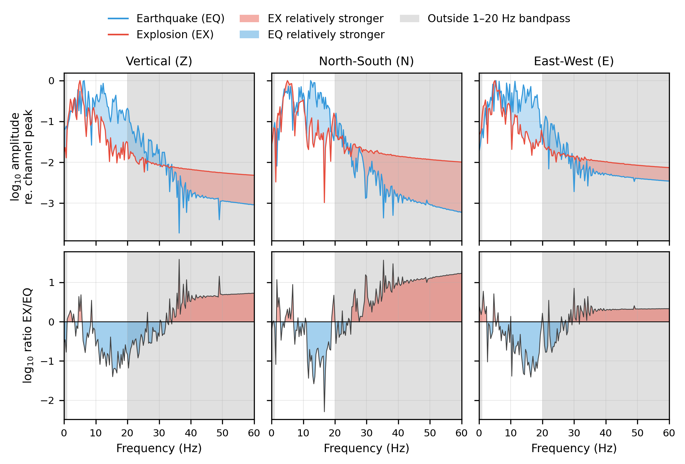
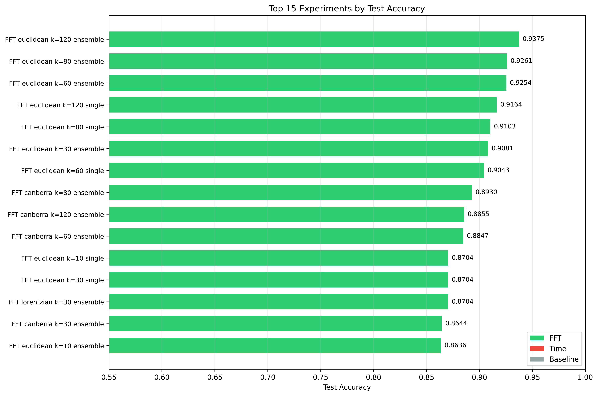
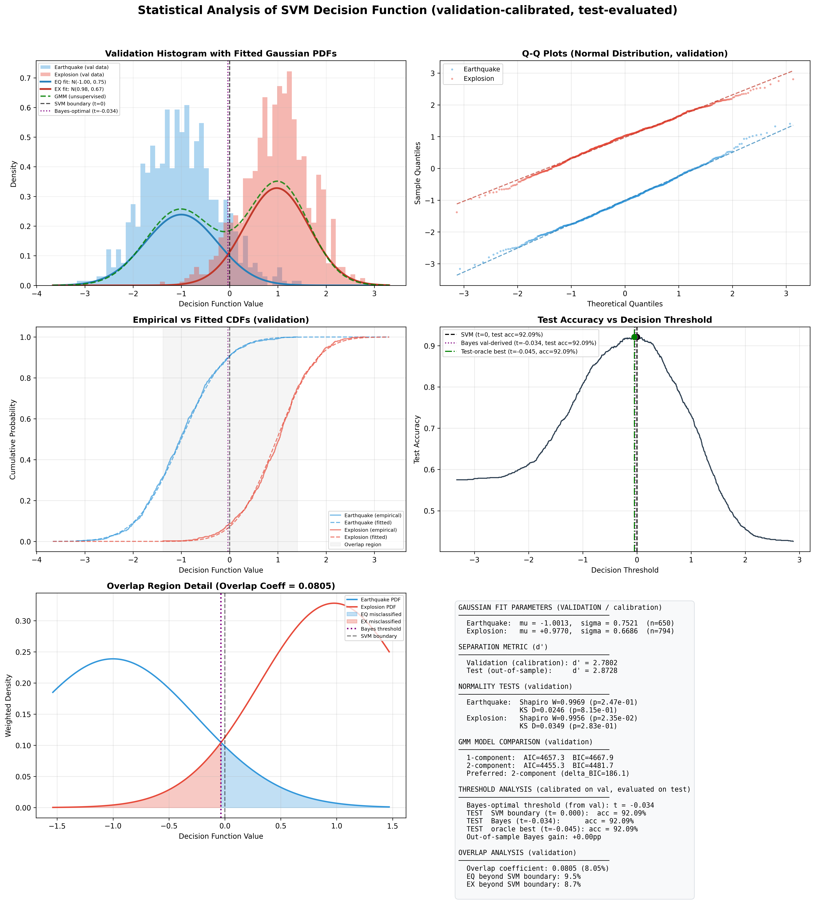
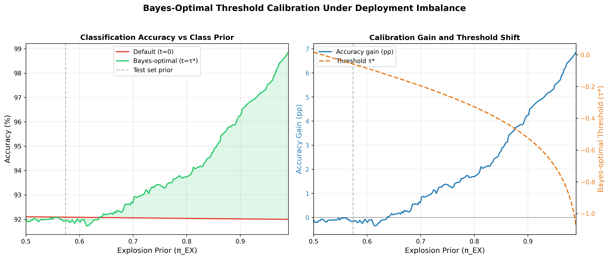

# Seismic Event Classifier

A machine learning system for classifying seismic events as **Earthquakes** or **Explosions** using FastMap dimensionality reduction, FFT-based feature engineering, SVM classification with ensemble voting, and Bayes-optimal decision threshold calibration.

Reference implementation for the manuscript *"A Frequency-Domain FastMap-SVM Ensemble for CPU-Efficient,
Near Real-Time Earthquake-Explosion Discrimination"* (submitted to **Computers & Geosciences**).
Reproduces every figure and table in the paper. Runs on a commodity CPU: no GPU required.

**Headline results** — 93.90% window-level and 96.97% event-level accuracy on a held-out test set of
1,327 station-windows from 165 events, against 62.62% for a Random Forest baseline.

## Project Goal

- Classify seismic waveforms as earthquakes or explosions
- Evaluate the impact of frequency-domain features (FFT) vs raw time-series
- Conduct a systematic ablation study across distance metrics, embedding dimensions, and ensemble methods
- Perform deep statistical analysis of the SVM decision function as a Gaussian mixture, with Bayes-optimal threshold calibration

## Project Structure

```text
seismic-event-classifier/
├── data/
│   ├── dataset_train.h5                  # Training split (6,334 samples)
│   ├── dataset_val.h5                    # Validation split (1,444 samples)
│   └── dataset_test.h5                   # Test split (1,327 samples)
├── SeismicDataset/
│   ├── build_training_dataset.py         # Combine per-station HDF5 into unified dataset
│   ├── split_by_event.py                 # Event-level stratified train/val/test split
│   ├── select_good_stations.py           # Filter stations by minimum window counts
│   ├── metadata.json                     # Event catalog metadata
│   ├── station_metadata.csv              # Station coordinates and info
│   └── summary_plots/                    # Dataset summary visualizations
├── output/
│   ├── ablation/
│   │   ├── models/                       # Saved models (.joblib)
│   │   ├── embeddings/                   # FastMap embeddings (.npy)
│   │   ├── results/                      # Per-experiment JSON + ablation_summary.json
│   │   └── plots/                        # Ablation comparison plots
│   ├── decision_boundary_plots/          # Decision boundary & spectral analysis plots
│   ├── test_predictions.csv              # Window-level test predictions (1,327 rows)
│   ├── event_level_predictions.csv       # Event-level predictions (165 rows)
│   ├── advisor_table.csv                 # Window-level results for advisor review
│   └── advisor_event_level.csv           # Event-level results for advisor review
├── src/
│   ├── ablation_config.py                # Ablation study configuration
│   ├── ablation.py                       # Ablation study runner
│   ├── plot_ablation.py                  # Plot generation from ablation results
│   ├── plot_decision_boundary.py         # Decision boundary & spectral analysis plots
│   ├── plot_gmm_analysis.py              # GMM statistical analysis of decision function
│   ├── plot_threshold_calibration.py     # Threshold calibration under deployment imbalance
│   ├── dataloader.py                     # HDF5 data loading
│   ├── distances.py                      # 9 distance metric implementations
│   ├── fastmap.py                        # FastMap algorithm
│   ├── classifier.py                     # FastMapSVM + BayesThresholdCalibrator + Baseline
│   └── post_review/
│       ├── export_test_predictions.py    # Export window-level test predictions to CSV
│       ├── event_level_predictions.py    # Aggregate to event-level via majority vote
│       ├── p_only_and_distance.py        # P- vs S-onset accuracy; distance baseline and matched-distance accuracy
│       ├── export_advisor_table.py       # Generate advisor review tables
│       ├── plot_station_map.py           # Station map visualization
│       ├── plot_advisor_examples.py      # Paper Fig. 2 (example pair) and Fig. 6 (spectra and ratio)
│       └── extract_example_waveforms.py  # Extract example waveforms for figures
├── figures/                              # Figures embedded in this README
├── advisor_figures/                      # Figures contributed by domain advisor (GSI)
├── README.md
├── requirements.txt
└── .gitignore
```

## Pipeline

### Waveform preprocessing (upstream of this repository's models)

Windows are produced by `SeismicDataset/400_extract_event_wfs_antelope.py` from the continuous archive:

- **Window**: 3.0 s — 0.5 s before to 2.5 s after a **cataloged phase arrival at that station** (not the
  event origin time), at 200 Hz, giving 600 samples per channel. Each station contributes up to two
  windows per event, one aligned on the P arrival and one on the S arrival (4,642 P-onset and 4,463
  S-onset windows); `python -m src.post_review.p_only_and_distance` writes per-window phase labels.
- **Filter**: 1–20 Hz bandpass, applied with a 5 s lead-in buffer that is then discarded so filter
  transients fall outside the retained window.
- **Channels**: three components (Z, N, E), from the first available of HH\*, BH\*, SH\*, EN\*.
- **Station selection**: a station is kept only if it yields at least 20 valid earthquake and 20 valid
  explosion windows; 12 of 111 stations qualified.

```
Raw Seismic Data (N, 600, 3)     600 timesteps x 3 channels (Z, N, E)
        |
   [FFT branch]                  [Time branch]
        |                              |
  rfft -> |magnitude|            flatten (N, 1800)
  -> log10 -> L2 norm
  -> flatten (N, 903)
        |                              |
        +--------- FastMap (N, k) -----+
                       |
                 StandardScaler
                       |
              SVM (tuned on val set)
                       |
             Retrain on train + val
                       |
            [Single] or [Ensemble x5]
                       |
         Bayes Threshold Calibration
          (fit Gaussians per class,
           shift threshold for priors)
                       |
              Final eval on test set
```

### Data Split Protocol

| Split | Samples | Role |
|-------|---------|------|
| **Train** | 6,334 | FastMap fitting + SVM training |
| **Validation** | 1,444 | Hyperparameter selection (no cross-validation) |
| **Test** | 1,327 | Final evaluation only |

After selecting the best hyperparameters on the validation set, the model is retrained on **train + val combined** before evaluating on test. The test set is never seen during tuning.



Paper Fig. 6: per-channel spectra of one earthquake (event 123583 at OFRI) and one explosion (event 399313 at ZFRI), the same pair as the paper's Fig. 2. Top: spectra normalized to each channel's peak. Bottom: log10 explosion/earthquake ratio. The band outside the 1-20 Hz bandpass is shaded.

## Ablation Study

We swept across 4 axes to isolate the contribution of each design choice:

| Axis | Values |
|------|--------|
| Feature domain | FFT (log-magnitude spectrum) vs raw time-series |
| Distance metric | Euclidean, Lorentzian, Canberra |
| FastMap dimensions (k) | 2, 10, 30, 60, 80, 120 |
| Model type | Single SVM vs Ensemble (5 voters, majority vote) |

**Total: 72 experiments + 1 baseline** (36 configs x single/ensemble + Random Forest baseline)

### Results: Top Configurations

| Rank | Config | Test Acc | Val Acc |
|------|--------|----------|---------|
| 1 | FFT + Euclidean, k=120, ensemble | **93.90%** | 91.20% |
| 2 | FFT + Euclidean, k=80, ensemble | 92.99% | 89.75% |
| 3 | FFT + Euclidean, k=120, single | 92.31% | 91.20% |
| 4 | FFT + Euclidean, k=60, ensemble | 92.24% | 88.64% |
| 5 | FFT + Euclidean, k=80, single | 91.26% | 89.75% |
| - | Baseline (Random Forest) | 62.62% | 64.54% |



### Key Findings

**1. FFT is the single most important factor**

FFT features outperform time-domain features in 35 of the 36 matched configurations; for k >= 10 the margin runs from 2.3 to 24.0 percentage points. The best time-domain result (Lorentzian, k=120, ensemble: 79.73%) is still far below the best FFT result (93.90%). The single exception is Lorentzian at k=2, where a two-dimensional embedding is too coarse for either representation.

The reason is that the discriminants for this problem are spectral, so a log-spectral representation exposes the properties that separate the classes and lets the SVM weight the frequency bands from data. In this dataset the spectral contrast reflects propagation as well as source: explosions are recorded at about 2.5× the distance of earthquakes, and window-level accuracy at matched distance is 86.8% (see `src/post_review/p_only_and_distance.py`). Windows are cut relative to the phase arrival at each station, so arrival-time alignment is handled by the windowing, not by the transform.

**2. Euclidean distance dominates on FFT features**

| Distance | Best Test Acc (ensemble) |
|----------|------------------------|
| Euclidean | 93.90% |
| Canberra | 89.15% |
| Lorentzian | 86.51% |

Euclidean outperforms alternatives by 1-9% in the FFT domain. Lorentzian and Canberra, which were designed for robustness to outliers and relative differences, don't help when the features are already well-normalized by the FFT+L2 pipeline.

**3. More dimensions help, with diminishing returns**

| k | Euclidean FFT (ensemble) |
|---|--------------------------|
| 2 | 61.19% |
| 10 | 87.19% |
| 30 | 90.66% |
| 60 | 92.24% |
| 80 | 92.99% |
| 120 | 93.90% |

k=2 is essentially useless. The jump from k=10 to k=30 is large (+4.5%), then gains taper off. k=80-120 is the sweet spot.

Notably, Lorentzian *degrades* at higher k (peaks at k=30, drops at k=60+), suggesting it doesn't scale well with many dimensions.

**4. Ensemble consistently improves accuracy**

Ensemble voting (5 independent FastMap projections with different random pivots) consistently improves accuracy by 1-7.5 percentage points. For Euclidean distance, the gain is a steady 1.5-3pp across all k values. For weaker metrics like Lorentzian, gains reach up to 7.5pp (at k=80), as ensemble voting compensates for suboptimal pivot selection.

**5. Validation accuracy tracks test accuracy well**

The val-vs-test scatter plot shows strong correlation, confirming the validation set is a reliable proxy for generalization and the model is not overfitting to the validation split.

### Per-Class Performance

Best model (FFT + Euclidean, k=120, ensemble):
- Earthquake F1: 0.929
- Explosion F1: 0.947

The model is slightly better at detecting explosions, likely because their spectral signatures (sharp high-frequency peaks) are more distinctive than the diffuse energy patterns of earthquakes.

### Event-Level Predictions

The window-level accuracy (93.90%) measures per-station performance, but operationally the goal is to classify each **event**. Since multiple stations record the same event, we aggregate window predictions to event-level using majority vote across all windows from the same event.

| Prediction Type | Window Acc | Event Acc | Delta |
|-----------------|-----------|-----------|-------|
| Single          | 92.31%    | 95.76%    | +3.45pp |
| Calibrated      | 91.94%    | 94.55%    | +2.61pp |
| Ensemble        | 93.90%    | **96.97%** | +3.07pp |

Event-level ensemble accuracy reaches **96.97%** — only 5 out of 165 test events misclassified. The improvement is expected: station-specific path effects and noise are independent across stations, so majority voting across windows smooths out individual station errors.

Per-class event-level breakdown (ensemble):
- Earthquake: 74/75 correct (98.67%)
- Explosion: 86/90 correct (95.56%)

```bash
python -m src.post_review.event_level_predictions
```

## Statistical Analysis of the Decision Function

The SVM decision-function values for each class closely resemble Gaussian distributions. We analyze this on a single SVM model (FFT + Euclidean, k=120): the ensemble combines five models by majority vote and has no single decision function, so the analysis characterizes the individual models within it. Following the paper's out-of-sample protocol, the analysis model is trained on the training split, every quantity below is calibrated on the validation split, and the test split is used only for evaluation (paper Section 5.8; Supplementary Material, Sections S-III and S-IV).

### Gaussian Mixture Model Validation

We fit a Gaussian to each class's validation decision values and, separately, a 2-component GMM to the pooled (unlabeled) validation decision values.

| Fit | Class | Mean (mu) | Std (sigma) | Weight |
|-----|-------|-----------|-------------|--------|
| Supervised | Earthquake (n=650) | -1.00 | 0.75 | 0.450 |
| Supervised | Explosion (n=794) | +0.98 | 0.67 | 0.550 |
| Unsupervised GMM | Component 1 | -1.03 | 0.71 | 0.452 |
| Unsupervised GMM | Component 2 | +1.01 | 0.63 | 0.548 |



**The unsupervised GMM recovers the class structure without labels.** Its component means lie within 0.05 of the supervised means, and its weights within 0.02 of the validation class proportions (45.0%/55.0%). The two-class structure is therefore intrinsic to the decision function rather than an artifact of supervised fitting.

**Model selection favors 2 components.** BIC is 4667.9 for one component and 4481.7 for two (delta_BIC ≈ 186). Because delta_BIC approximates twice the log Bayes factor, it can be read on the Kass & Raftery (1995) scale, where values above 10 count as "very strong" evidence; 186 is far beyond that.

### Normality Tests

| Test | Earthquake (n=650) | Explosion (n=794) |
|------|-----------|-----------|
| Shapiro-Wilk W | 0.9969 (p=0.247) | 0.9956 (p=0.023) |
| Kolmogorov-Smirnov D | 0.0246 (p=0.815) | 0.0349 (p=0.283) |

The KS test cannot reject normality for either class. The more tail-sensitive Shapiro-Wilk test flags a statistically significant but small departure for the explosion class (W > 0.99 for both classes); the Q-Q plots show that the deviations are confined to the extreme tails.

### Sensitivity Index (d-prime)

The d-prime (d') from signal detection theory measures class separability as the distance between the class means in pooled standard deviations:

$$d' = \frac{|\mu_{EX} - \mu_{EQ}|}{\sqrt{(\sigma_{EQ}^2 + \sigma_{EX}^2)/2}}$$

With the validation fits, d' = 2.78; the same class-conditional model gives d' = 2.87 on the held-out test set. For two equal-variance Gaussians, a d' in this range corresponds to an ideal-observer accuracy of about 92%, close to the single SVM's test accuracy (92.09%).

### Bayes-Optimal Threshold Calibration

The standard SVM decision boundary sits at `decision_function(x) = 0`, which implicitly assumes equal class priors. The Bayes-optimal threshold is where the prior-weighted class densities cross:

$$P(EQ) \cdot \mathcal{N}(x; \mu_{EQ}, \sigma_{EQ}) = P(EX) \cdot \mathcal{N}(x; \mu_{EX}, \sigma_{EX})$$

With the validation fits and validation priors (45% earthquakes, 55% explosions), tau* = -0.034. On the held-out test set:

| Threshold | Value | Test accuracy |
|-----------|-------|---------------|
| SVM default | t = 0.000 | 92.09% |
| Bayes-optimal (from validation) | t = -0.034 | 92.09% |
| Test-set oracle | t = -0.045 | 92.09% |

At these near-balanced priors the SVM default is already at the Bayes-optimal point, and calibration changes nothing (+0.00 pp).

The `BayesThresholdCalibrator` class in `classifier.py` implements this. It also accepts custom priors for deployment scenarios with different class ratios (e.g., real-world monitoring where explosions vastly outnumber earthquakes).

### Calibration Under Deployment Imbalance

In operational monitoring the class mix can be far more imbalanced than in a curated dataset. We simulated this by computing prior-weighted test accuracy under varying explosion priors, with tau* derived from the validation-calibrated Gaussians:

| Scenario | π_EX | Threshold τ* | Acc (t=0) | Gain |
|----------|------|-------------|-----------|------|
| Balanced | 50% | +0.016 | 92.10% | −0.11pp |
| Test set | 57% | −0.059 | 92.09% | −0.15pp |
| Moderate | 70% | −0.196 | 92.06% | +0.56pp |
| High | 80% | −0.328 | 92.04% | +1.73pp |
| Severe | 90% | −0.523 | 92.02% | **+4.24pp** |
| Operational | 95% | −0.699 | 92.01% | **+5.50pp** |
| Extreme | 99% | −1.077 | 92.00% | **+6.86pp** |

At the test-set balance the SVM default is already near-optimal. As the explosion prior rises, calibration gains 4-7 pp with no retraining, only a threshold shift derived from the fitted Gaussians. These gains come from reweighting the test set; validation on a genuinely imbalanced operational catalog is still to be done.



### Overlap Analysis

The overlap coefficient between the two prior-weighted class distributions is 0.081 (8.1%), a lower bound on the Bayes error for any classifier operating on the decision function alone. The empirical validation error rates are close to this bound:

- Earthquakes beyond the SVM boundary: 9.5%
- Explosions beyond the SVM boundary: 8.7%

The near-symmetry of the per-class error rates despite unequal priors follows from `class_weight='balanced'` in the SVM, which equalizes each class's contribution to the soft-margin loss.

## Generated Plots

All plots are saved to `output/ablation/plots/` by running `python -m src.plot_ablation`:

| Plot | Description |
|------|-------------|
| `fft_vs_time.png` | FFT vs time-domain accuracy by distance metric |
| `accuracy_vs_k_fft.png` | Accuracy scaling with k for each distance (FFT) |
| `accuracy_vs_k_time.png` | Same for time domain |
| `single_vs_ensemble.png` | Scatter: single vs ensemble accuracy for all configs |
| `ensemble_gain.png` | Percentage gain from ensemble by distance and k |
| `f1_per_class.png` | Per-class F1 scores for best configs |
| `heatmap_fft_single.png` | Accuracy heatmap: distance x k (FFT, single) |
| `heatmap_fft_ensemble.png` | Same for ensemble |
| `heatmap_time_single.png` | Accuracy heatmap (time domain, single) |
| `heatmap_time_ensemble.png` | Same for ensemble |
| `val_vs_test.png` | Validation vs test accuracy (overfitting check) |
| `overall_ranking.png` | Top 5 FFT experiments alongside the best time-domain model and the Random Forest baseline |
| `domain_gap.png` | FFT advantage in percentage points at each k |

### Decision Boundary & Spectral Analysis

Saved to `output/decision_boundary_plots/` by running `python -m src.plot_decision_boundary`:

| Plot | Description |
|------|-------------|
| `tsne_clusters.png` | t-SNE of k=120 embeddings — class labels (left) and SVM confidence heatmap (right) |
| `decision_histogram.png` | Distribution of SVM decision function values per class — shows class separation and misclassification rates |
| `decision_boundary_best2dims.png` | SVM boundary on the 2 most discriminative FastMap dimensions |
| `misclassified_tsne.png` | t-SNE with misclassified samples highlighted |
| `average_spectra.png` | Mean FFT spectrum per class per channel (Z/N/E) with standard deviation bands |
| `spectral_difference.png` | Explosion minus earthquake mean spectrum — shows which frequencies are discriminative |
| `example_waveforms.png` | Single earthquake vs explosion raw waveform comparison |
| `example_spectra.png` | FFT spectra of the same example events |

Note: `plot_decision_boundary` draws its example pair at random and writes it to `example_waveforms` and `example_spectra`, overwriting the paper's Fig. 2 files. Run the commands under "Generate the Paper's Figures 2 and 6" afterwards to restore them.

### Paper Figures 2 and 6

Saved to `output/decision_boundary_plots/` by `src/post_review/plot_advisor_examples.py`, for earthquake 123583 at OFRI and explosion 399313 at ZFRI:

| Plot | Description |
|------|-------------|
| `example_waveforms.pdf`, `example_spectra.pdf` | Fig. 2: three-component waveforms and spectra of the pair |
| `spectra_and_ratio_by_channel.pdf` | Fig. 6: per-channel peak-normalized spectra of the pair (top) and log10 explosion/earthquake ratio (bottom) |

### GMM Statistical Analysis

Saved to `output/decision_boundary_plots/` by running `python -m src.plot_gmm_analysis`:

| Plot | Description |
|------|-------------|
| `decision_function_analysis.png` | 6-panel figure: (1) histogram with fitted Gaussian PDFs + GMM overlay + threshold markers, (2) Q-Q plots for normality assessment, (3) empirical vs fitted CDFs, (4) accuracy vs threshold sweep, (5) overlap region detail with error shading, (6) full statistics summary |

### Threshold Calibration Analysis

Saved to `output/decision_boundary_plots/` by running `python -m src.plot_threshold_calibration`:

| Plot | Description |
|------|-------------|
| `threshold_calibration.png` | 2-panel figure: (1) accuracy with default vs calibrated threshold across explosion priors, (2) gain and threshold shift as a function of prior |
| `threshold_calibration_results.json` | Full numerical results for all simulated scenarios |

## How to Run

### Setup

```bash
conda create -n seismic python=3.12 -y
conda activate seismic
pip install -r requirements.txt
```

Place the HDF5 data files in `data/`.

### Run Ablation Study

```bash
python -m src.ablation
```

Progress is printed with ETA after each experiment. Partial results are saved incrementally.

### Generate Ablation Plots

```bash
python -m src.plot_ablation
```

### Generate Decision Boundary & Spectral Plots

```bash
python -m src.plot_decision_boundary
```

### Generate the Paper's Figures 2 and 6

```bash
python -m src.post_review.plot_advisor_examples
python -c "from src.post_review.plot_advisor_examples import plot_spectra_and_ratio_pair; plot_spectra_and_ratio_pair(123583, 'OFRI', 399313, 'ZFRI', fmax=60.0)"
```

The first command writes Fig. 2 and the second Fig. 6.

### Generate GMM Statistical Analysis

```bash
python -m src.plot_gmm_analysis
```

### Generate Threshold Calibration Analysis

```bash
python -m src.plot_threshold_calibration
```

### Export Test Predictions

```bash
python -m src.post_review.export_test_predictions
```

### Event-Level Predictions

```bash
python -m src.post_review.event_level_predictions
```

### P-Onset Accuracy and Distance Checks

```bash
python -m src.post_review.p_only_and_distance
```

### Model Loading

```python
import joblib
model = joblib.load("output/ablation/models/ablation_FFT_euclidean_k120_single.joblib")
svm = model['svm']
scaler = model['scaler']
fastmap = model['fastmap']
```

### Bayes Threshold Calibration

```python
from src.classifier import BayesThresholdCalibrator

# After training an SVM, calibrate the threshold on a labeled set
decision_vals = svm.decision_function(X_scaled)
calibrator = BayesThresholdCalibrator()
calibrator.fit(decision_vals, y_labels)
y_pred = calibrator.predict(svm.decision_function(X_test_scaled))

# For deployment with known class imbalance (e.g., 95% explosions)
calibrator.fit(decision_vals, y_labels, priors={0: 0.05, 1: 0.95})
```

## Distance Metrics

| Metric | Description |
|--------|-------------|
| Euclidean | Standard L2 norm |
| Lorentzian | Log-based, robust to outliers: sum(log(1 + \|u-v\|)) |
| Canberra | Relative differences: sum(\|u-v\| / (\|u\|+\|v\|)) |
| Cosine | 1 - cosine similarity |
| NCC | Normalized cross-correlation (waveform alignment) |
| Wasserstein | Earth mover's distance on normalized spectra |
| Kulczynski | Intersection-based similarity |
| Soergel | Jaccard-like: sum(\|u-v\|) / sum(max(u,v)) |
| Likelihood Ratio | KL-divergence based |

## Requirements

- Python 3.8+ (developed and tested on 3.12)
- numpy >= 1.21, scipy >= 1.7, scikit-learn >= 1.0, h5py >= 3.1, matplotlib >= 3.4, joblib >= 1.1
- No GPU or other accelerator required. Timings in the paper were measured on an Apple M4 (Mac mini, 16 GB RAM).

## Data availability

The three-component waveform dataset and event catalogs analyzed in this work were provided by the
Geological Survey of Israel and are shared with its permission under the Creative Commons
Attribution-NonCommercial 4.0 (CC BY-NC 4.0) license:

- Zenodo: https://doi.org/10.5281/zenodo.24137901

The HDF5 splits under `data/` are not tracked in this repository; download them from the Zenodo record
and place them in `data/` before running the pipeline.

## Citation

If you use this software or the accompanying dataset, please cite:

```bibtex
@article{frist_earthquake_explosion,
  author  = {Frist, Yehuda and Partouche, Yossi and Sogavker, Ido and Gorstein, Marina
             and Polozov, Andrey and Navon, Hila and Cohen, Sarel and Kurzon, Ittai},
  title   = {A Frequency-Domain {FastMap-SVM} Ensemble for {CPU}-Efficient,
             Near Real-Time Earthquake-Explosion Discrimination},
  journal = {Computers \& Geosciences},
  note    = {Submitted},
  year    = {2026}
}
```

## License

Source code is released under the MIT License (see `LICENSE`). The dataset is licensed separately under
CC BY-NC 4.0 via the Zenodo record above.

## Authors

- Yehuda Frist (Reichman University) — corresponding author, yehuda.frist@post.runi.ac.il
- Yossi Partouche (Reichman University)
- Ido Sogavker (Reichman University)
- Marina Gorstein (Geological Survey of Israel)
- Andrey Polozov (Geological Survey of Israel)
- Hila Navon (Geological Survey of Israel)
- Sarel Cohen (Reichman University)
- Ittai Kurzon (Geological Survey of Israel)